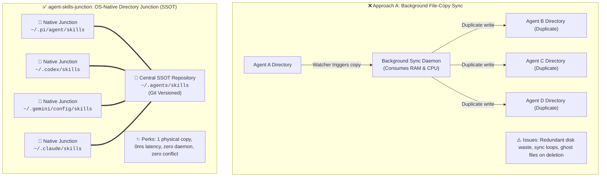

[中文说明](README.md) | English

# Agent Skills Junction 🚀

[](LICENSE)
[](#)
[](#)
[](#)

> **The Zero-Friction, Single-Source-of-Truth Hub for All Your AI Agent Skills.**  
> Effortlessly share skills across **Pi (ThinkRail)**, **Codex CLI**, **Gemini / Antigravity**, **Claude Code**, **Continue**, **OpenHands**, and **Cursor** using native NTFS Directory Junctions and POSIX Symlinks.  
> **No CLI commands required—just talk to your Agent.**

---

## 💡 Why `agent-skills-junction`?

Modern developers frequently run multiple Agent harnesses concurrently: Pi for editor workflows, Codex for CLI automation, Gemini / Antigravity for reasoning and long-context analysis, and Claude Code for reviews.

However, each client typically manages skills in its own isolated directory (`~/.pi/...`, `~/.codex/...`, `~/.gemini/...`), causing:
1. **Tool Silos**: A powerful skill installed in Client A is completely invisible in Client B;
2. **Disk Fragmentation**: The same skill is repeatedly cloned or copied into multiple redundant copies;
3. **Ghost File Rebirth**: Traditional two-way file-sync daemons consume system memory, and deleting a skill in Client A causes the daemon to treat Client B as a newer source, copying the deleted file right back in an endless loop.

**The Solution**: By leveraging native operating system filesystem mechanics, all client skill directories transparently redirect to one central truth source (`~/.agents/skills`). **Strictly 1 physical instance, 0ms latency, zero background footprint.**

---

## ✨ Key Features

- **100% Conversational UX**: Aligned with Agentic workflows. Install, create, and remove skills directly in chat—no leaving your IDE or learning private CLIs.
- **Single Physical Instance (Zero Duplication)**: Only one physical copy exists on disk. All harnesses read the exact same source, eliminating version drift.
- **Zero Runtime Overhead**: No Node.js or Python background daemons. Zero memory, zero CPU consumption—pure OS kernel filesystem routing.
- **Seamless on Windows**: Powered by native **NTFS Directory Junctions**. No Developer Mode and no Administrator UAC elevation required.
- **Low Intrusion & High Compatibility**: Does not modify agent binaries, environment variables, or model prompts. Purely transparent storage redirection.
- **Pre-Merge Safe Guard**: Before converting any physical directory into a junction, existing unique skills are automatically merged into the central repository to guarantee zero asset loss.

> [!NOTE]
> **Windows Permission Note**  
> Unlike Windows Symlinks which typically demand Developer Mode or Administrator UAC elevation, **NTFS Directory Junctions** are a fundamental filesystem feature supported natively in standard user environments without privileges.

> [!TIP]
> **Safety Net Against Accidental Deletions**  
> The central repository `~/.agents/skills` is Git-versioned by default. If an Agent accidentally removes a critical skill, restore it in 1 second via: `git checkout -- <skill-name>`.

---

## ⚡ Architecture Comparison: Traditional Sync vs. Native Junction



---

## 🚀 Quick Start

Run the setup script once; all future skill lifecycle tasks are managed conversationally.

### 1. Clone the Repository

```bash
git clone https://github.com/tanfeng13545/agent-skills-junction.git
cd agent-skills-junction
```

### 2. Run Setup Once

#### Windows (PowerShell)

```powershell
# 1. Preview mode (safe dry-run, no changes made)
.\scripts\sync.ps1 -DryRun

# 2. Apply junctions and safely merge existing skills
.\scripts\sync.ps1
```

#### Linux / macOS (Bash)

```bash
chmod +x scripts/sync.sh
./scripts/sync.sh
```

---

## 💬 Daily Conversational Usage

After setup, **you never need to run scripts or terminal commands again**.

### Scenario A: Install an Online Skill
Simply instruct your Agent in natural language:
> 🗣️ *"Hey, install this skill for me: https://github.com/op7418/guizang-social-card-skill"*

The Agent writes to its default path, which NTFS transparently routes to `~/.agents/skills`. **The moment it replies, all other Agents on your machine immediately gain that skill.**

### Scenario B: Create a Custom Skill
> 🗣️ *"Create a new skill for summarizing code review changes according to our team standards."*

The skill becomes immediately available across all your tools.

### Scenario C: Cleanly Remove a Skill (Zero Ghost Rebirth)
> 🗣️ *"Uninstall and remove the `test-dummy-skill` skill for me."*

Because only one physical instance exists, removing it deletes the source directly. **Every peer Agent sees it disappear instantly with no background daemon resurrecting it.**

---

## 🔍 Verification & Diagnostics

Verify junction status at any time:

### Windows
```powershell
# List central skills
Get-ChildItem "$HOME\.agents\skills" -Name

# Verify junction target (should show LinkType: Junction)
Get-Item "$HOME\.pi\agent\skills" | Select-Object Name, LinkType, Target
```

### Linux / macOS
```bash
ls -la ~/.pi/agent/skills
# Output shows -> ~/.agents/skills
```

---

## 🔄 Uninstallation & Clean-up

To revert back to isolated standalone directories:

1. Delete the junction points (central skills remain intact):
   ```powershell
   cmd /c rmdir "$HOME\.pi\agent\skills"
   ```
2. Re-create ordinary directories as needed.

---

## 🥊 Benchmark Matrix

| Feature / Dimension | Approach A: File-Watcher Daemons | Approach B: External CLI Managers | Approach C: Generic Dotfiles Tools | ✅ **agent-skills-junction (Native SSOT)** |
| :--- | :--- | :--- | :--- | :--- |
| **Interaction Model** | Background daemon monitoring disk | Dedicated CLI commands (`tool install ...`) | Manual synchronization (`tool apply`) | **100% Conversational (Natural language with Agent)** |
| **Storage Efficiency** | Creates duplicated physical copies | Multiple copies across tool dirs | Single copy via symlinks | **Single physical instance (Zero disk duplicate)** |
| **Change Reflection** | Polling delay (3s - 60s) | Command execution required | Commit & apply cycle | **Instant (0ms OS-level reparse reflection)** |
| **Conflict Possibility** | Risk of sync loops & overwrites | Low risk | Dependent on branch merges | **None (Single truth source, no synchronization needed)** |
| **Runtime Footprint** | Constant background memory usage | External runtime / binary needed | Git / Go tooling dependencies | **Zero footprint (Native OS filesystem pointers)** |
| **Windows Usability** | Works without elevation | Works without elevation | Symlinks often require Developer Mode | **Seamless (NTFS Junctions require no elevation)** |
| **Harness Agility** | Often tightly coupled to specific tools | Limited to supported ecosystem | Manual mapping rules | **Universal (Pi, Codex, Gemini, Claude, Cursor, etc.)** |

---

## 🤝 Supported Harnesses

Configured in `config/harnesses.json`:

- 🟢 **Pi (ThinkRail)** (`~/.pi/agent/skills`)
- 🟢 **Codex CLI** (`~/.codex/skills`)
- 🟢 **Gemini / Antigravity** (`~/.gemini/config/skills` & `~/.gemini/antigravity-cli/skills`)
- 🟢 **Claude Code** (`~/.claude/skills`)
- 🟢 **Cursor / OpenHands / Continue** (extensible)

---

## 📄 License

This project is licensed under the [MIT License](LICENSE).