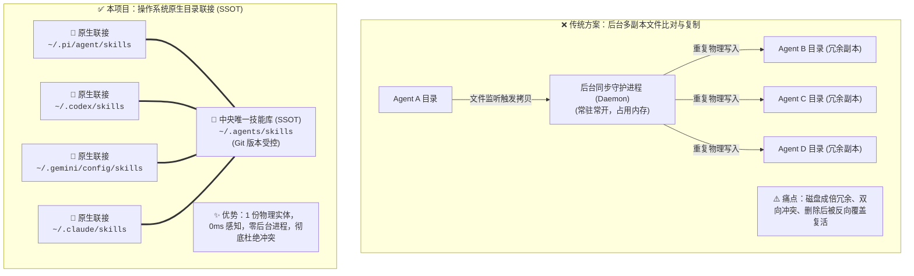

中文 | [English](README.en.md)

# Agent Skills Junction 🚀

[](LICENSE)
[](#)
[](#)
[](#)

> **真正符合 AI 交互直觉的多 Agent 技能统一中枢（Single Source of Truth, SSOT）。**  
> 致力于解决多 AI 客户端（Pi / ThinkRail、Codex CLI、Gemini / Antigravity、Claude Code、Cursor、OpenHands 等）之间的**技能孤岛割裂、磁盘碎片冗余、配置版本漂移**与传统文件同步中的**幽灵文件复活**问题。  
> **装技能无需任何专用命令行工具——直接在日常对话中交代你的 Agent。**

---

## 💡 为什么需要本项目？

随着多 Agent 工具链的发展，很多工程师电脑里同时运行着多个客户端：写代码用 Pi、命令行调度用 Codex、长文档推理用 Gemini / Antigravity，特定审查任务用 Claude Code。

但每个客户端都在自己的私有目录独立维护技能（`~/.pi/...`、`~/.codex/...`、`~/.gemini/...`），直接导致：
1. **技能孤岛**：在 A 工具配好的神器技能，换到 B 工具完全感知不到；
2. **磁盘碎片**：同一技能在本地被反复下载与拷贝成多份冗余副本；
3. **幽灵文件反弹**：传统文件双向同步脚本常驻后台吃内存，且在 A 工具删除了技能，后台同步器又从 B 把它误判为新增文件重新复制回来，陷入删不掉的死循环。

**解法**：基于操作系统文件系统底层能力，让所有客户端的技能目录全部透明映射至同一个中央物理源（`~/.agents/skills`）。**全机仅保留 1 份物理实体，0 毫秒即时穿透，零常驻后台开销。**

---

## ✨ 核心特性

- **100% 对话式交互**：遵循 Agentic 原生心智，安装、定制、卸载技能全部直接在聊天框告诉 AI，无需退出终端使用任何私有 CLI。
- **物理单实例（零冗余）**：全机技能只存一份，任何客户端读取的都是同一物理文件，彻底终结多副本同步带来的版本漂移。
- **绝对零资源开销**：不运行任何 Node.js / Python 后台守护进程（Daemon），不占用任何内存与 CPU，纯粹由操作系统内核文件系统寻址。
- **免提权无感接入**：Windows 平台采用原生 **NTFS Directory Junction（目录联接）**，无需开启开发者模式，无需管理员 UAC 提权，普通用户权限一键完成。
- **低侵入性与高兼容性**：不篡改任何 Agent 客户端代码，不注入全局环境变量，不侵入模型 Prompt，仅重定向存储路径，天然兼容后续版本升级。
- **内置防丢并集迁移（Pre-Merge Safeguard）**：首次建立联接前，自动扫描已有客户端中的独有技能并合并归档至中央库，确保历史资产 100% 不丢失。

> [!NOTE]
> **关于 Windows 权限的特别说明**  
> Windows 下的符号链接（Symlink）通常需要系统「开发者模式」或管理员权限，而本项目在 Windows 平台严格采用原生 **NTFS Directory Junction（目录联接）**，受操作系统文件系统底层原生支持，**普通终端权限即可直接运行与创建**。

> [!TIP]
> **防误删安全气囊**  
> 中央仓库 `~/.agents/skills` 原生受 Git 版本控制保护。如果让 AI 误删了自研重要技能，在中央库执行一行 `git checkout -- <skill-name>` 即可 1 秒找回。

---

## ⚡ 架构对比：传统同步 vs 原生目录联接



---

## 🚀 快速开始

本项目仅需在初次使用时执行一次配置脚本，后续全自动化流转。

### 1. 克隆仓库

```bash
git clone https://github.com/tanfeng13545/agent-skills-junction.git
cd agent-skills-junction
```

### 2. 执行一键联接

#### Windows（PowerShell）

```powershell
# 1. 安全预览模式（检查将要接管的客户端路径，不修改任何文件）
.\scripts\sync.ps1 -DryRun

# 2. 正式执行（自动安全合并存量资产 + 建立底层联接）
.\scripts\sync.ps1
```

#### Linux / macOS（Bash）

```bash
chmod +x scripts/sync.sh
./scripts/sync.sh
```

---

## 💬 日常使用方式（自然语言驱动）

配置完成后，**你永远不需要再手动运行任何脚本或命令**。

### 场景一：安装线上开源技能
直接在任意 Agent 的聊天框中发指令：
> 🗣️ *「帮我装一下这个开源技能：https://github.com/op7418/guizang-social-card-skill」*

Agent 会自动通过文件写入落盘到其默认目录，经由 NTFS 联接穿透，物理数据瞬间写入中央仓库。**当前 Agent 提示完成的同时，全机所有其他 Agent 立即拥有该项能力。**

### 场景二：定制与沉淀团队技能
> 🗣️ *「根据我们团队的代码规范，编写一个代码评审技能并落盘保存。」*

AI 编写完成后即时全端漫游，切换到另一款客户端无需二次配置即可直接调度。

### 场景三：彻底卸载技能（杜绝幽灵文件）
> 🗣️ *「帮我把刚才测试的 `test-dummy-skill` 技能卸载/删除掉。」*

由于全机仅存在一份物理实体，删除指令穿透作用于中央源，**全机所有客户端同步清除，绝无任何后台同步机制将其「反向拷贝复活」**。

---

## 🔍 状态检查与验证

你可以通过以下命令快速验证联接状态：

### Windows
```powershell
# 查看中央库技能列表
Get-ChildItem "$HOME\.agents\skills" -Name

# 检查特定客户端联接属性（显示为 Junction 即表示成功）
Get-Item "$HOME\.pi\agent\skills" | Select-Object Name, LinkType, Target
```

### Linux / macOS
```bash
ls -la ~/.pi/agent/skills
# 输出包含 -> ~/.agents/skills 即表示软链接正常生效
```

---

## 🔄 卸载与清理

如果你希望完全撤销本项目的联接并恢复为传统的各独立目录：

1. 移除各客户端的联接点目录（不会影响中央仓库内的文件实体）：
   ```powershell
   # Windows 示例：移除特定客户端联接
   cmd /c rmdir "$HOME\.pi\agent\skills"
   ```
2. 重新创建普通的物理文件夹即可。

---

## 🥊 深度对比矩阵

| 评估维度 | 方案 A：后台文件比对同步器 | 方案 B：专属包管理器 CLI | 方案 C：通用 Dotfiles 软链 | ✅ **agent-skills-junction (本项目)** |
| :--- | :--- | :--- | :--- | :--- |
| **交互心智** | 依赖后台轮询，等待同步 | 需频繁退出聊天在终端敲命令 | 需手动 commit / push / apply | **100% 对话式（直接跟 Agent 说话）** |
| **存储开销** | 多处物理拷贝，产生大量碎片 | 多处副本分别下载 | 单份存储 | **物理单实例（零重复存储）** |
| **生效延迟** | 存在轮询时间差（数秒至分钟） | 需逐个工具执行命令拉取 | 需手动触发拉取 | **0 毫秒（OS 文件系统底层即时穿透）** |
| **覆盖与冲突** | **极高**（并发覆盖、删不掉的幽灵文件） | 较低 | 依赖手动解决冲突 | **绝对零冲突（物理单一源，无同步概念）** |
| **系统驻留资源** | 常驻 Node/Python 进程吃内存 | 需安装运行环境依赖 | 依赖版本管理工具 | **绝对零开销（纯操作系统文件系统特性）** |
| **Windows 门槛** | 普通权限 | 普通权限 | 原生符号链接常需开发者模式提权 | **开箱即用（NTFS Junction 零提权）** |
| **客户端适配** | 往往局限于固定工具 | 依赖官方扩展支持 | 需手动配置映射清单 | **开箱全生态（Pi / Codex / Gemini / Claude 等）** |

---

## 🤝 支持的 Agent 客户端列表

通过 `config/harnesses.json` 声明支持的客户端清单，目前已原生支持：

- 🟢 **Pi (ThinkRail)** (`~/.pi/agent/skills`)
- 🟢 **Codex CLI** (`~/.codex/skills`)
- 🟢 **Gemini / Antigravity** (`~/.gemini/config/skills` & `~/.gemini/antigravity-cli/skills`)
- 🟢 **Claude Code** (`~/.claude/skills`)
- 🟢 **Cursor / OpenHands / Continue**（按需扩展）

如需接入更多客户端，只需在 `config/harnesses.json` 中追加对应路径规则即可。

---

## 📄 开源许可证

本项目基于 [MIT License](LICENSE) 开源发布。