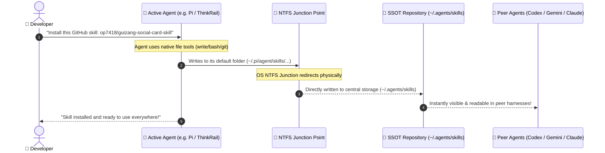
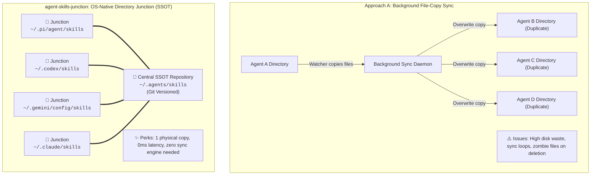

# Agent Skills Junction 🚀

> **The Zero-Friction, Single-Source-of-Truth Hub for All Your AI Agent Skills.**  
> Effortlessly share skills across **Pi (ThinkRail)**, **Codex CLI**, **Gemini / Antigravity**, **Claude Code**, **Continue**, **OpenHands**, and **Cursor** using native NTFS Directory Junctions and POSIX Symlinks.  
> **No CLI commands required—just talk to your Agent.**

English | [中文说明](./README_CN.md)

---

## ⚡ The Modern Reality: How Developers Actually Install Skills

You don't install skills with manual terminal commands anymore. In the Agentic era, **you simply instruct your AI Agent in natural language**:

> 🗣️ *"Hey, install this skill for me: https://github.com/op7418/guizang-social-card-skill"*  
> 🗣️ *"Create a new skill for analyzing financial reports and save it."*

**Without `agent-skills-junction`:**
The Agent writes the skill into its own siloed directory (e.g., `~/.pi/agent/skills/`). Codex, Gemini, and Claude will have no knowledge of it. You are trapped in tool fragmentation.

**With `agent-skills-junction`:**
The Agent writes to its default path as usual, but the OS transparently pipes the writes into your central repository (`~/.agents/skills`). **The moment your Agent finishes writing, every other Agent on your machine immediately gains that capability.**

---

## 📊 Lifecycle Flowchart



---

## 🥊 Benchmark: Why `agent-skills-junction` Outperforms Existing Alternatives

| Feature / Dimension | Approach A: File-Watcher Daemons | Approach B: External CLI Managers | Approach C: Generic Dotfiles Tools | ✅ **agent-skills-junction (Native SSOT)** |
| :--- | :--- | :--- | :--- | :--- |
| **Interaction Model** | Background daemon monitoring disk | Dedicated CLI commands (`tool install ...`) | Manual synchronization (`tool apply`) | **100% Conversational (Natural language with Agent)** |
| **Storage Efficiency** | Creates duplicated physical copies | Multiple copies across tool dirs | Single copy via symlinks | **Single physical instance (Zero disk duplicate)** |
| **Change Reflection** | Polling delay (3s - 60s) | Command execution required | Commit & apply cycle | **Instant (0ms OS-level reparse reflection)** |
| **Conflict Possibility** | Risk of sync loops & overwrites | Low risk | Dependent on branch merges | **None (Single truth source, no synchronization needed)** |
| **Runtime Footprint** | Constant background memory usage | External runtime / binary needed | Git / Go tooling dependencies | **Zero footprint (Native OS filesystem pointers)** |
| **Windows Usability** | Works without elevation | Works without elevation | Symlinks often require Developer Mode | **Seamless (NTFS Junctions require no elevation)** |
| **Harness Agility** | Often tightly coupled to specific tools | Limited to supported ecosystem | Manual mapping rules | **Universal (Pi, Codex, Gemini, Claude, Cursor, etc.)** |

---

## 🏗️ Architecture Comparison: Why File-Copy Syncing Fails



---

## 🚀 Quick Setup (One-Time Execution)

### Windows (PowerShell)

1. Clone or download this repository:
   ```powershell
   git clone https://github.com/tanfeng13545/agent-skills-junction.git
   cd agent-skills-junction
   ```

2. Run the sync script once:
   ```powershell
   # Preview mode (safe check)
   .\scripts\sync.ps1 -DryRun

   # Apply junctions & consolidate existing skills into SSOT
   .\scripts\sync.ps1
   ```

### Linux / macOS (Bash)

```bash
chmod +x scripts/sync.sh
./scripts/sync.sh
```

---

## 💬 How to Use in Daily Work

After running the setup, **you never need to run scripts again**.

### Scenario A: Install an Online Skill
Just ask your current AI assistant:
> *"Help me install this skill from GitHub: https://github.com/op7418/guizang-social-card-skill"*

### Scenario B: Create a Custom Skill
> 🗣️ *"Create a new skill for summarizing code review changes according to our team standards."*

The AI will write it, the OS will direct it into `~/.agents/skills`, and you can immediately switch to any other Agent harness and use it right away.

### Scenario C: Cleanly Uninstall/Remove a Skill (Zero "Zombie Rebirth")
> 🗣️ *"Uninstall and remove the `test-dummy-skill` skill for me."*

* **The Nightmare of File-Copy Syncing**: Deleting a skill in Client A causes the background sync daemon to treat Client B as the newer source, copying the deleted skill right back into Client A in an endless "zombie file loop".
* **Our Native Junction Solution**: Because there is strictly one physical instance, deletion by any Agent cleanly eliminates it from the central store. **Every peer Agent sees it vanish in 0ms**.
* **Safety Net for Accidental Deletion**: If an Agent accidentally deletes an important custom skill, Git versioning on `~/.agents/skills` lets you restore it in seconds: `git checkout -- <skill-name>`.

---

## 🛡️ Built-in Safeguards

1. **Pre-Merge Safe Guard**: Before converting any existing physical skill directory to a junction, `sync.ps1` scans for unique skills and consolidates them into the central repository. **No existing skills are ever lost.**
2. **Git Versioned**: `~/.agents/skills` can be initialized as a Git repository. Any skill additions or deletions can be versioned, reviewed, and rolled back with standard Git commands.
3. **Idempotent**: Re-running the script is 100% safe; existing junctions are automatically detected and preserved.

---

## 📄 License

This project is licensed under the [MIT License](./LICENSE).