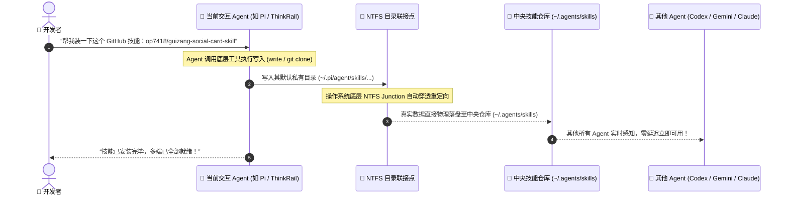
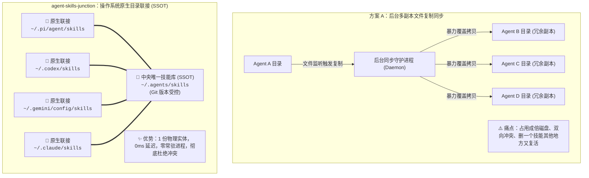

# Agent Skills Junction 🚀

> **真正符合 AI 交互直觉的多 Agent 技能统一中枢。**  
> 基于 Windows 原生 NTFS 目录联接（Directory Junction）与 POSIX 符号链接，打通 **Pi / ThinkRail**、**Codex CLI**、**Gemini / Antigravity**、**Claude Code**、**Continue**、**OpenHands** 与 **Cursor**。  
> **装技能无需任何命令行——直接在对话中告诉你的 Agent。**

[English](./README.md) | 中文说明

---

## ⚡ 现代开发直觉：我们到底如何「安装」一个 Skill？

在真正的 Agentic 时代，开发者根本不需要打开终端敲击繁琐的命令行工具去管理技能。**你只需要在日常对话中用自然语言对 Agent 说一句话**：

> 🗣️ *「帮我装一下这个技能：https://github.com/op7418/guizang-social-card-skill」*  
> 🗣️ *「帮我写一个分析财务报表的 Skill 并沉淀下来。」*

**没有 `agent-skills-junction` 时：**
当前 Agent 会把技能写进它自己的私有孤岛目录（例如 `~/.pi/agent/skills/`）。当你切换到 Codex、Gemini 或 Claude 时，它们对此一无所知，你被迫陷入工具割裂。

**使用 `agent-skills-junction` 后：**
当前 Agent 依旧按照它原有的习惯写入，而操作系统底层（NTFS Junction）会自动将数据穿透写入中央仓库（`~/.agents/skills`）。**在当前 Agent 提示「写入完成」的同一毫秒，你电脑上的所有其他 Agent 已经同步获得了该项新技能。**

---

## 📊 技能生命周期流转图



---

## 🥊 深度对标：为什么本项目能够降维打击现有方案？

| 技术维度 | 方案 A：后台文件监听同步器 | 方案 B：外部包管理器 CLI 工具 | 方案 C：通用 Dotfiles 软链管理 | ✅ **agent-skills-junction (本项目)** |
| :--- | :--- | :--- | :--- | :--- |
| **交互心智** | 依赖后台守护进程轮询磁盘 | 需退出聊天切换到终端运行专属命令 | 每次改动后需手动执行 apply 生效 | **100% 对话式 Agent 原生（聊天直接告知）** |
| **存储开销** | 多处复制物理副本，易形成碎片冗余 | 各工具维护专属副本，重复占用 | 软链映射，配置相对复杂 | **物理单实例（零额外存储，杜绝副本）** |
| **生效延迟** | 存在轮询延迟（数秒至数十秒） | 需手动逐一命令触发更新 | 需提交并手动触发应用 | **0 毫秒（操作系统底层原生重解析，即时生效）** |
| **冲突与丢失风险** | 双向覆盖与循环同步风险较高 | 风险较低 | 依赖手动分支与冲突合并 | **天然零冲突（单一物理事实源，无同步概念）** |
| **运行时资源开销** | 需常驻后台守护进程（Node/Python） | 需安装外部运行时与专属命令行 | 依赖外部包管理器或编译工具链 | **绝对零开销（纯操作系统底层文件系统能力）** |
| **Windows 权限适配** | 普通权限 | 普通权限 | 原生符号链接往往需开启开发者模式或提权 | **开箱即用（NTFS Junction 无需管理员权限）** |
| **工具生态适配度** | 通常硬编码适配少数 1~2 个工具 | 受限于特定支持名单 | 需自行维护路径匹配清单 | **生态通用（无缝覆盖 Pi、Codex、Gemini 等）** |

---

## 🏗️ 架构对比：传统「文件复制同步」为什么必然失败？



---

## 🚀 极简配置（仅需运行一次）

### Windows（PowerShell）

1. 下载或克隆本项目：
   ```powershell
   git clone https://github.com/tanfeng13545/agent-skills-junction.git
   cd agent-skills-junction
   ```

2. 运行同步映射引擎：
   ```powershell
   # 1. 模拟预览（安全模式，不修改任何文件系统）
   .\scripts\sync.ps1 -DryRun

   # 2. 正式执行（自动安全合并存量技能，并打通底层联接）
   .\scripts\sync.ps1
   ```

### Linux / macOS（Bash）

```bash
chmod +x scripts/sync.sh
./scripts/sync.sh
```

---

## 💬 日常开发中的使用方式

配置完成后，**你永远不需要再运行任何同步脚本或命令**。

### 场景一：安装线上开源技能
直接在任何聊天界面告诉你的 AI 助手：
> *「帮我安装这个 GitHub 技能：https://github.com/op7418/guizang-social-card-skill」*

### 场景二：让 Agent 为你定制专属技能
> *「根据我们团队的代码规范，编写一个代码评审技能并保存下来。」*

AI 写入完成后，底层直接落盘中央库，你可以立刻无缝切换到任意其他 Agent 客户端直接调用。

---

## 🛡️ 安全防御机制

1. **防丢并集迁移（Pre-Merge Safeguard）**：在将任何物理私有目录替换为联接点之前，`sync.ps1` 会自动深度扫描目标目录，将中央库中尚未收录的独有技能先安全合并进中央库，**确保已有资产绝对零丢失**。
2. **Git 版本回溯支持**：中央库 `~/.agents/skills` 原生支持 Git 版本管理。任何技能的新增、修改或删除均有迹可循，随时可一键 `git checkout` 撤销回滚。
3. **幂等设计**：重复运行脚本百分之百安全，脚本会自动跳过已建立的联接点。

---

## 📄 开源许可证

本项目采用 [MIT 许可证](./LICENSE)。